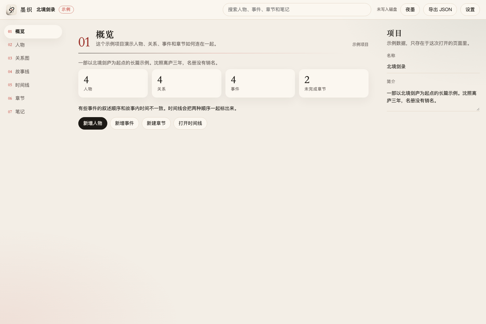
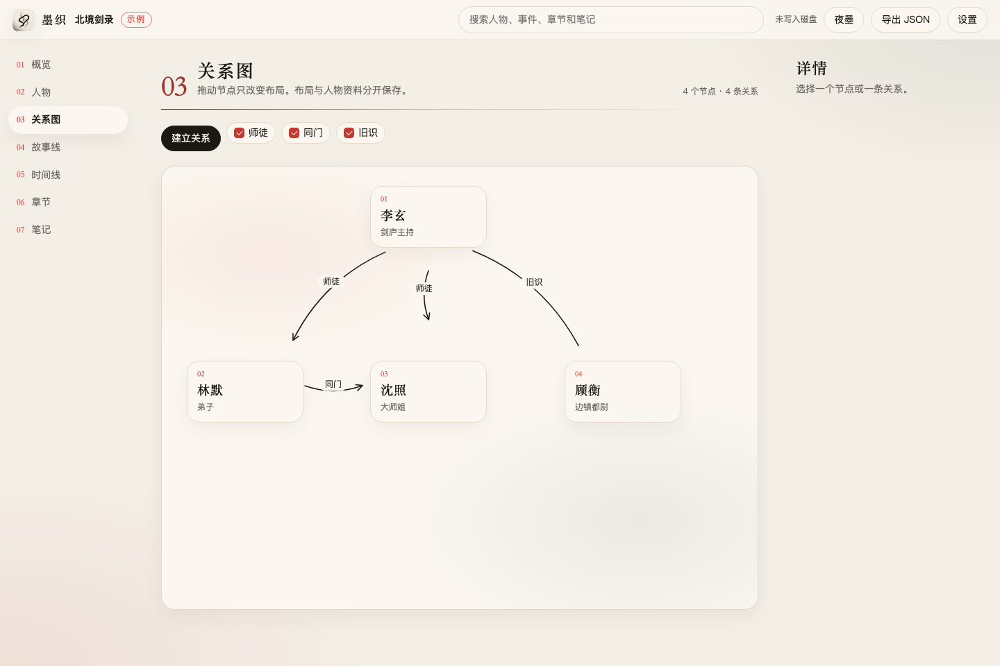
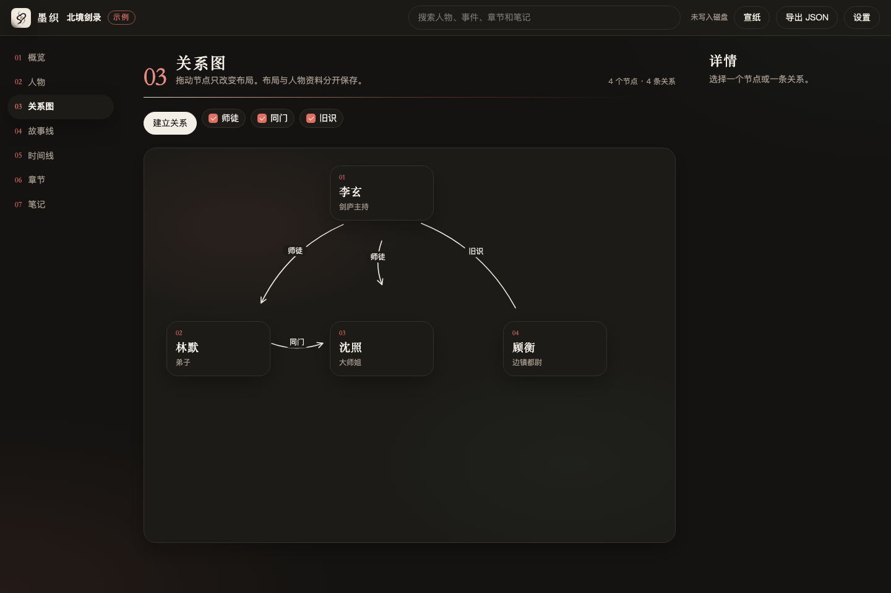

<p align="center">
  
</p>

<h1 align="center">StoryWeave</h1>

<p align="center">
  <strong>墨织</strong><br>
  开源、单机的小说构思与创作软件。当前是桌面版。<br>
  把人物、关系、事件、时间线与章节脉络编织在一起。
</p>

<p align="center">
  <a href="https://github.com/certainstar/StoryWeave"></a>
  <a href="https://github.com/certainstar/StoryWeave/stargazers"></a>
  <a href="https://github.com/certainstar/StoryWeave/releases"></a>
  <a href="LICENSE"></a>
  
  
</p>

<p align="center">
  <a href="#原型">原型</a> ·
  <a href="#下载">下载</a> ·
  <a href="Docs/PRD.md">产品需求</a> ·
  <a href="Docs/OKR.md">OKR</a> ·
  <a href="Docs/Planning.md">技术规划</a> ·
  <a href="Docs/Privacy.md">隐私</a> ·
  <a href="Changelog/CHANGELOG.md">变更记录</a>
</p>

StoryWeave 帮助作者在正式写作前后整理创意：建立人物档案，画出人物关系，排列故事线和故事内时间，并把这些对象连回章节正文。项目留在作者自己的电脑上。软件不建立账号，也不保存用户信息。打开项目不需要网络。

作者若要多台设备互通，可以导入项目文件、连接自己的远端仓库，或自行配置。这些通路可以接到插件槽上。移动端留到桌面版之后再评估。

桌面应用在本仓库里开发。安装包会发到 [Releases](https://github.com/certainstar/StoryWeave/releases)。当前还没有公开发布的安装包。

## 原型

<p align="center">
  
</p>

<p align="center">
  
</p>

<p align="center">
  
</p>

克隆仓库后，用浏览器打开原型：

```bash
git clone https://github.com/certainstar/StoryWeave.git
cd StoryWeave
open Prototype/index.html
```

Windows 可以直接双击 `Prototype/index.html`。

顶栏可以在 **宣纸** 和 **夜墨** 之间切换。选择会留在这台浏览器里。原型里的「北境剑录」是示例项目，修改只留在当前页面；刷新后会回到初始数据。顶栏的「导出 JSON」会下载这份会话，文件格式标记为 `storyweave.prototype`。

窗口窄于 960px 时，页面会提示拉宽。墨织按桌面工作台设计。

## 功能

第一版要让一位作者离线完成一部长篇的构思和资料整理。

| 模块 | 能做的事 |
| --- | --- |
| 项目 | 新建、打开、重命名、关闭，以及最近项目 |
| 人物 | 档案、别名、状态，以及这个人的关系、事件和章节 |
| 关系图 | 拖动节点、建立有向或无向关系、按类型筛选、保存布局 |
| 故事线 | 主线、支线、人物线和感情线，并调整事件顺序 |
| 时间线 | 按故事内时间排列，同时标出它在哪一章被讲到 |
| 章节 | Markdown 原文、预览、场景、出场人物和相关事件 |
| 笔记 | 尚未写成正式设定的灵感和世界观 |
| 搜索 | 查找人物、事件、故事线、章节和笔记 |
| 外观 | 宣纸与夜墨两套主题，选择记在本机 |
| 数据 | 自动保存、快照、恢复、导出和导入 |

关系图上的坐标单独保存，不写进人物档案。删除人物时会同时移除他的关系；章节和事件保留，只解除关联。

第一版不包含墨织自己的账号、托管同步、移动端界面、出版排版和模型自动改写。插件槽留作扩展点，不安装插件也能写作。模型辅助排在 MVP 之后，而且必须先给出候选、经作者确认再写入。

完整验收标准见 [产品需求文档](Docs/PRD.md)。

## 路线图

| 阶段 | 目标 |
| --- | --- |
| M0 | 验证桌面窗口、SQLite 和关系图能一起工作 |
| M1 | 可离线使用的 MVP：人物、关系、故事线、时间线、章节、搜索、备份、主题 |
| M2 | 可选的模型提取。关闭模型后，其余功能仍可用 |
| M3 | 一致性提示、伏笔状态、大图筛选、安装包发布 |
| M4 | 插件槽、作者自己的远端仓库鉴权、模板和自定义字段 |
| 之后 | 评估移动端。沿用同一套项目文件 |

实现顺序和风险见 [技术规划](Docs/Planning.md)。

## 技术栈

| 层次 | 选型 |
| --- | --- |
| 桌面容器 | Tauri 2 |
| 本地能力 | Rust：SQLite、文件、窗口 |
| 界面 | Vue 3、TypeScript、Vite、Pinia |
| 关系图 | Vue Flow |
| 正文 | CodeMirror 6，Markdown 原文与预览 |
| 数据 | 一份 SQLite。正文先存在库里，再导出为 Markdown / JSON |
| 测试与 CI | Vitest、Rust 测试、GitHub Actions |

本地数据库、文件和窗口由 Tauri 进程里的 Rust 命令完成。已定选型见 [TechStack.md](Docs/TechStack.md)，命令、表和错误码见 [API.md](Docs/API.md)、[DataModel.md](Docs/DataModel.md)、[Errors.md](Docs/Errors.md)。写作顺序见 [OKR.md](Docs/OKR.md)。

## 仓库结构

```text
StoryWeave/
├── Docs/
│   ├── PRD.md                 # 产品需求
│   ├── OKR.md                 # 本阶段目标与写作顺序
│   ├── Planning.md            # 技术规划
│   ├── TechStack.md           # 已定技术选型
│   ├── API.md                 # 本机命令
│   ├── DataModel.md           # 项目库表结构
│   ├── Errors.md              # 错误码
│   ├── Privacy.md             # 隐私
│   └── assets/                # 图标与原型截图
├── Prototype/                 # 可交互原型
├── Frontend/                  # 桌面应用（Vue + Tauri + Rust，见下）
├── .github/workflows/         # macOS、Windows、Linux 构建
├── Changelog/
│   └── CHANGELOG.md
├── CONTRIBUTING.md
├── CODE_OF_CONDUCT.md
├── SECURITY.md
├── LICENSE
└── README.md
```

根目录只放文档、原型和开源说明。桌面应用都在 `Frontend/`：

```text
Frontend/
├── src/                   # Vue 界面
├── public/
├── src-tauri/             # Rust 命令与 SQLite
├── package.json           # pnpm dev / pnpm build
├── pnpm-lock.yaml
└── rust-toolchain.toml
```

## 下载

安装包会发布在 [GitHub Releases](https://github.com/certainstar/StoryWeave/releases)。

当前发布桌面版。移动端以后再评估。

| 平台 | 计划 |
| --- | --- |
| macOS | 随 MVP 提供，并做真实安装验证 |
| Windows | 随 MVP 提供，并做真实安装验证 |
| Linux | 随贡献完善 |

在安装包发布之前，可以在本机启动桌面窗口，或用浏览器打开上面的原型。

## 开发

需要 Node.js、pnpm，以及 stable Rust：

```bash
cd Frontend
pnpm install
pnpm dev          # 启动 Tauri 桌面窗口
```

只看界面、不启动窗口时：

```bash
cd Frontend
pnpm dev:web
```

浏览器里的开发服务器使用内存仓库，刷新后数据留在这台浏览器。桌面窗口里的数据写入本机 SQLite。

打当前系统的安装包：

```bash
cd Frontend
pnpm build
```

macOS、Windows 和 Linux 由 [`.github/workflows/build.yml`](.github/workflows/build.yml) 同一套矩阵构建。本机先确认当前系统能编过并启动。

参与方式见 [CONTRIBUTING.md](CONTRIBUTING.md)。

## 数据与隐私

- 单机使用。不保存用户账号或个人资料，项目留在本机。
- 打开和编辑不需要网络。默认不上传正文，也不采集遥测。
- 多端互通由作者导入文件、连接自己的远端仓库，或通过插件槽自行配置。凭据不进入墨织的用户库。
- 日志不记录密钥，也不记录正文全文。
- 模型调用不进入 MVP。以后若接入远程模型，发送前会说明哪些文本会离开本机。
- 原型不会把示例项目写入磁盘。主题选择只留在浏览器本地。

细节见 [Privacy.md](Docs/Privacy.md)。

## 参与贡献

欢迎用 [Issues](https://github.com/certainstar/StoryWeave/issues) 讨论需求和缺陷，也欢迎提交 Pull Request。较大的改动请先对照 [PRD](Docs/PRD.md)；涉及数据库结构的改动需要附上迁移方式和已有项目如何打开。

请不要在 Issue 或提交记录里粘贴密钥、未发表的小说正文，或别人的私人材料。安全问题请通过仓库的 [Security Advisories](https://github.com/certainstar/StoryWeave/security/advisories) 私下报告，说明见 [SECURITY.md](SECURITY.md)。参与讨论请遵守 [行为准则](CODE_OF_CONDUCT.md)。

## 许可证

[MIT](LICENSE)。Copyright (c) 2026 竹墨清水若尘。
